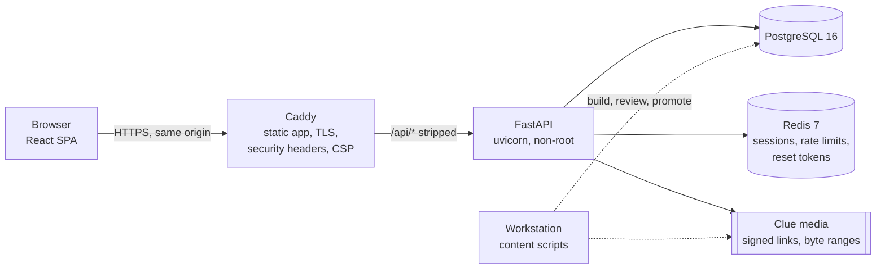

# Daily Game Challenge

A website with daily puzzle games: one new puzzle per game per day, playable in a few minutes, with or without an account. The first game is the **game guesser**: guess a video game from six clues, a growing cut of a screenshot first and a gameplay clip last, with six tries. Progress, stats and streaks are kept in the browser for guests and on the server for accounts, and a guest's games move into the account on sign-up.

This is the umbrella repo. It holds the product spec, the architecture, the API contract between the two apps, the production setup and the plans. The code lives in two repos:

| Repo | What it is |
|---|---|
| [daily-game-challenge-be](https://github.com/oleksandr-shvab/daily-game-challenge-be) | Backend: FastAPI, Python 3.12, PostgreSQL 16, Redis 7 |
| [daily-game-challenge-fe](https://github.com/oleksandr-shvab/daily-game-challenge-fe) | Frontend: React, TypeScript, Vite, TanStack Router and Query |

It is a learning project, built to production standards and run locally for now: everything up to a real server and domain is done and tested on a laptop, and the steps that need hosting are written down in the [launch runbook](docs/runbooks/launch.md).

## Architecture



- **One origin.** Caddy serves the built app and proxies `/api` to the backend, so there is no CORS in production and the session cookie is `Secure`, `HttpOnly` and `SameSite=Lax`.
- **Server-side sessions** in Redis, not JWT. Answers never reach the browser before the game ends; clue images and clips of later steps are served only through short-lived signed links once earned.
- **Content pipeline.** Scripts import a list of about 27,000 games from IGDB, build puzzles from IGDB screenshots and Steam trailers (seeded with a secret salt, so the public code cannot predict an answer), and a local review page approves them before they are scheduled. Every puzzle credits its sources.
- **Contract-first.** The backend exports an OpenAPI snapshot; the frontend generates its API client from it (Orval), and CI fails when the two drift. The rules both sides follow are in [CONTRACTS.md](CONTRACTS.md).

## Highlights

**Security** — checked against all 45 lessons of [Hacksplaining](https://www.hacksplaining.com/lessons) ([audit and plan](plans/07-security-hardening.md))
- Strict Content Security Policy with no inline scripts and no `eval`, HSTS, `frame-ancestors 'none'`, `nosniff`, a referrer policy and a permissions policy, all set in one Caddyfile
- CSRF protection by exact `Origin` check and JSON-only bodies; argon2id passwords; rate limits in Redis on login, sign-up, password reset, guesses and search (429 with `Retry-After`)
- Startup refuses unsafe production settings (placeholder secrets, http URLs, localhost origins, limits switched off)
- Containers run as non-root on a read-only filesystem with all capabilities dropped; the database and Redis are never published
- Dependabot, `npm audit` in CI, and a written rule against adding packages by guessed names

**Testing and CI**
- About 1,600 backend tests (pytest, real Postgres and Redis) and 450 frontend unit and component tests (Vitest, Testing Library)
- Playwright end-to-end smoke tests at phone, tablet and desktop sizes, with axe accessibility checks (WCAG 2.2 AA) at every step
- CI on every pull request: lint, types, tests, migrations, the API contract, the Docker images, and a 12-check smoke script for the production stack

**Product**
- English and Russian interface; light and dark themes; keyboard and screen-reader friendly
- Guests play without an account; stats with streaks (with a 3-day grace), an archive of past days, a spoiler-free share text and a countdown to the next puzzle

## How it was built

Most of the code was written by AI agents (Claude Code), directed and reviewed by me. Every feature went through the same loop:

1. **Spec** with acceptance criteria ([specs/](specs/)), and decisions recorded in [SPEC.md](SPEC.md) (over 80 so far)
2. **Plan** split into pull requests with estimates ([plans/](plans/))
3. **Implementation** by one agent per pull request, then a **plan check** item by item, a **code review**, and a **test-writer** pass for routes and auth
4. **Review and merge** by me

The plans, specs and decisions in this repo are the record of that process.

## Documents

| | |
|---|---|
| [SPEC.md](SPEC.md) | Product and game spec, with every decision |
| [ARCHITECTURE.md](ARCHITECTURE.md) | Technical decisions for running it in production |
| [CONTRACTS.md](CONTRACTS.md) | The API contract: routing, auth cookie, errors, rate limits, media links |
| [MILESTONE-1.md](MILESTONE-1.md) | The first milestone's tasks and their state |
| [docs/runbooks/launch.md](docs/runbooks/launch.md) | Running the production stack locally, and every step a real launch needs |
| [specs/](specs/), [plans/](plans/) | Feature specs and implementation plans |

## Run it locally

You need Docker, [uv](https://docs.astral.sh/uv/) and Node 24. The app repos are checked out inside this one under their local folder names:

```sh
git clone https://github.com/oleksandr-shvab/daily-game-challenge.git
cd daily-game-challenge
git clone https://github.com/oleksandr-shvab/daily-game-challenge-be.git my-list-be
git clone https://github.com/oleksandr-shvab/daily-game-challenge-fe.git my-list-fe
```

**The production-like stack** (Caddy, API, Postgres, Redis, with `ENVIRONMENT=production` and dummy local secrets) at `https://dgc.localhost`:

```sh
mkdir -p var/prod-media
docker compose -f compose.prod.yml -f compose.admin.yml --env-file deploy/localhost.vars up -d --build
deploy/smoke.sh
```

Seed it with demo puzzles as described in [CLAUDE.md](CLAUDE.md) ("Production-like run on this laptop") and in part A of the [runbook](docs/runbooks/launch.md).

**Development servers:** see the READMEs of the [backend](https://github.com/oleksandr-shvab/daily-game-challenge-be#readme) and the [frontend](https://github.com/oleksandr-shvab/daily-game-challenge-fe#readme).

## Credits

Game data and screenshots come from [IGDB](https://www.igdb.com/), and gameplay clips from Steam trailers; each puzzle links to its sources. The site has no ads and no paywall.
